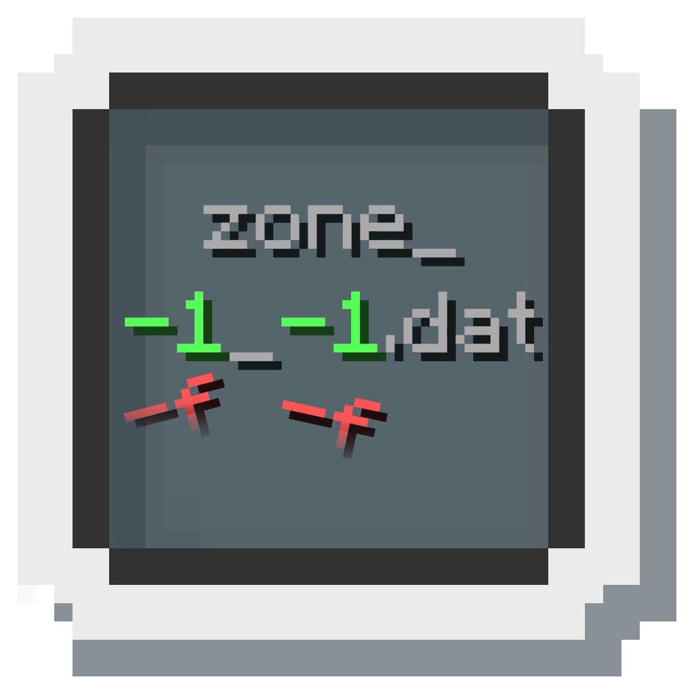

<h1 style="padding-top: 0;">LoadZone</h1>

A small Ornithe mod to fix Notch's broken Zone filename code in Infdev 20100624 and Beta 1.2_02-20110517

##### Companion mods
- [ZonifiedBeta](https://modrinth.com/mod/ZonifiedBeta) ([View Source](https://github.com/DexrnZacAttack/ZonifiedBeta))
  - A small mod to use the previously unused ZonedChunkStorage present in b1.2_02-20110517
- [NotSoSecret](https://modrinth.com/mod/NotSoSecret) ([View Source](https://github.com/DexrnZacAttack/NotSoSecret))
  - Disables Notch's SecretMode test code that forcefully drags the player into the `secretLevel` on load.
  - Also fixes the inventory bind not existing

#### Installation

##### inf-20100624
- Download the mod for inf-624
- Follow the "CLI Installation" part of the [Ornithe Installation guide on the Ornithe Wiki](https://wiki.ornithemc.net/wiki/Installing_Ornithe#CLI_Installation)
  - The generation should be `2`, and the Minecraft version should be set to `inf-20100624`, e.g. `ornithe-installer-rs prism --minecraft-version inf-20100624 --gen 2` for generating a Prism Launcher modpack archive.
- Once Ornithe is set up, drag the mod into the Mods folder inside the instance root.
- Launch the game.

##### b1.2_02-20110517
- Download the mod for your Minecraft version from the releases
  - Theoretically, the b1.2_02-20110517 version of this mod SHOULD work between Fabric-based loaders, as there is no dependency on the OSL itself, and b1.2_02-20110517 is already deobfuscated.
  - This has not been tested though.
- **Instructions still need to be written for this as Ornithe does not currently support `b1.2_02-20110517` outside of an experimental devenv made by somebody else.**

### *Why?*
When Notch was developing the Zone file format, he had set the filenames to use the chunk coordinates passed into the method, instead of using the Zone's coordinates.

Because of how the method is called, anytime the game attempts to get a chunk that is in a new zone, a new Zone file is created.

This breaks many things:
- Because the first chunk that is called for is not always at relative chunk offset `0,0`, the filenames are almost random, as they are based on whatever the first chunk the client decided to load was at that time. 
- World writers are broken, as the client will NOT load chunks whose chunk position does not match the Zone file's name.
  - In [libLodestone](https://github.com/Team-Lodestone/libLodestone), we have decided to follow the format of LoadZone by writing the Zone coordinates, instead of some random chunk coordinates.
- There's a chance that on load, the first chunk to load in a given Zone is NOT the same as the one that initially created it.
  - This means Zones may 'reset' outright after one or more rejoins.
- Loading a Zone from a different angle may cause it to generate a new zone. (untested!!!)
  - Again, it is all dependent on what chunk the client attempted to pull inside any given zone.
### *What's different?*
Zone files (`zone_{x}_{z}.dat`,`entity_{x}_{z}.dat`) now use their Zone coordinates in the filename, instead of the coords of the first chunk that would create the Zone file.   

<figure>
  
   
  <figcaption>A warning screen that appears when the user attempts to load a world which uses ZonifiedBeta, without ZonifiedBeta installed. Click the image to watch a showcase video of LoadZone, ZonifiedBeta, and NotSoSecret on YouTube</figcaption>
</figure>
 
 

> [!IMPORTANT]
> Worlds created with LoadZone are NOT compatible with vanilla clients.
>
> Likewise, worlds created in vanilla are NOT compatible with clients running LoadZone.
>
> To help prevent accidental loading, LoadZone checks for a marker file (`.loadzone`) before loading a world to determine whether it is safe to load.
> In the event the file does not exist (such as the world being vanilla), the player is notified that they are about to load a vanilla world, and is given the option to cancel.

### *But, what **are** zones?*
It is essentially McRegion before McRegion, with the format being written by Notch during the infdev era of Minecraft.

More info can be found at the [Minecraft Wiki page for the Zone File Format](https://minecraft.wiki/w/Zone_file_format), which was previously mostly undocumented before our discoveries during the development of libLodestone.
